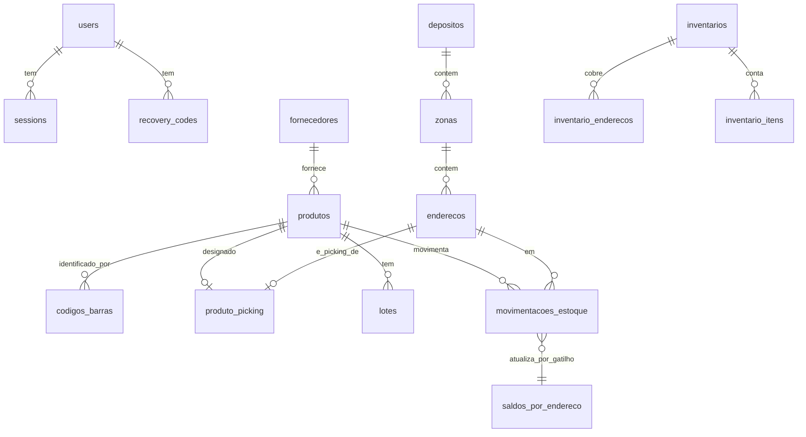

# Arquitetura

## Camadas

```
public/            front-end estático (módulos ES, CSP estrita)
src/http/          roteador, sessão, CSRF/Origin, idempotência, cabeçalhos, estáticos
src/security/      scrypt+pepper, TOTP, AES-256-GCM, rate limit, auditoria encadeada
src/modules/       regras de negócio e rotas por área (acesso, catalogo, deposito, estoque, inventario, consultas)
src/barcode/       GTIN, Code 128, EAN/UPC, QR, etiquetas (SVG e ZPL)
src/db.js          SQLite isolado (troca por PostgreSQL fica localizada aqui)
migrations/        SQL versionado
```

Fluxo de uma requisição: `Host` permitido → sessão (cookie, só o hash no banco) → etapa de acesso → limite de taxa → `Origin` + token CSRF (métodos que mudam dados) → JSON validado por esquema (só campos listados) → chave de idempotência (operações de estoque) → regra de negócio dentro de uma transação → auditoria na **mesma** transação.

## Modelo de dados (ER simplificado)



## Estoque: por que o saldo não mente

- `movimentacoes_estoque` é só-inserção (gatilhos barram `UPDATE`/`DELETE`).
- `saldos_por_endereco` só muda pelo gatilho `trg_mov_saldo`, na mesma transação da movimentação.
- `CHECK (qtd >= 0)` no saldo: mesmo que a aplicação falhe, o banco recusa saldo negativo.
- `integridade()` recalcula a soma do razão e compara com os saldos (painel, Configurações e testes).
- Valores em centavos; peso em gramas; medidas em mm; datas em milissegundos UTC; validade `AAAA-MM-DD`.

## Fases

| Fase | Conteúdo | Status |
|---|---|---|
| 0 | Fundação (config, migrations, logs, testes) | ✅ |
| 1 | Acesso seguro, usuário único, MFA, auditoria | ✅ |
| 2 | Cadastros, EAN, fornecedores | ✅ |
| 2.5 | Design system, shell, paleta, PWA | ✅ (captura de tela automatizada pendente) |
| 3 | Endereçamento, livro-razão, put-away, transferência, inventário, mapa | ✅ (variações e kits pendentes) |
| 4 | Alertas por e-mail/WhatsApp, compras e recebimento por pedido de compra | ⏳ (alertas no painel e reposição já existem) |
| 5 | Hub de integrações (Mercado Livre, Shopee, Bling/Tiny) | ⏳ |
| 6 | Fluxo do pedido, reserva, separação mobile, conferência, embalagem | ⏳ |
| 7 | Etiquetas de transportadora, DANFE, romaneio, rastreio | ⏳ |
| 8 | Devoluções, relatórios, painel completo | ⏳ |
| 9 | Endurecimento final, carga, restauração de backup | ⏳ |

## Pontos de extensão já preparados

- `zonas.vendavel` separa disponível de físico (base do "disponível = físico − reservado").
- `movimentacoes_estoque.tipo` já prevê `DEVOLUCAO` e `SAIDA`; a reserva (`reservas`) entra na Fase 6.
- `idempotencia` é genérica: serve para importar pedido uma única vez.
- `produto_picking` + `reposicao()` são a base das tarefas de reabastecimento.
